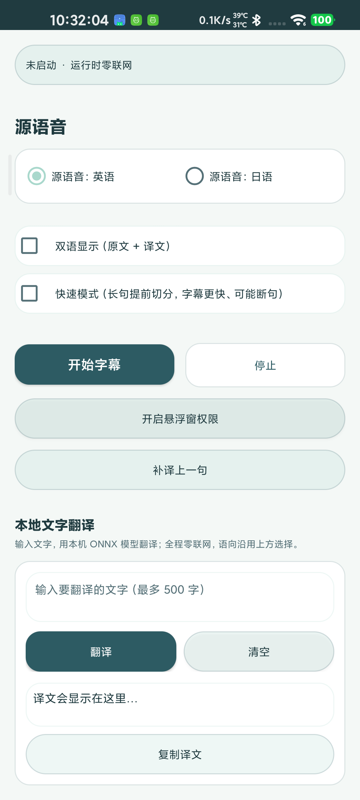
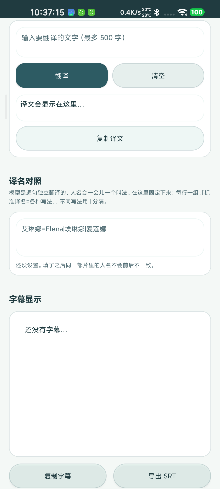

<p align="center">
  
</p>

<h1 align="center">浮译 · LiveSubtitle</h1>

<p align="center">
  <b>把正在播放的声音，变成屏幕上的中文字幕。</b><br />
  开源的 Android 离线实时字幕应用 · 系统内录 · 零联网 · 无账号 · 无埋点
</p>

<p align="center">
  <a href="https://github.com/xyzOvO/LiveSubtitle/releases/latest"></a>
  <a href="https://github.com/xyzOvO/LiveSubtitle/stargazers"></a>
  <a href="LICENSE"></a>
  
  
  
  
</p>

<p align="center">
  <a href="#download">📲 下载</a> ·
  <a href="#features">✨ 功能</a> ·
  <a href="#ui">🖼 界面</a> ·
  <a href="#models">🎯 语向与模型</a> ·
  <a href="#build">🛠 构建</a> ·
  <a href="#faq">❓ 常见问题</a> ·
  <a href="#internals">🧩 实现原理</a> ·
  <a href="#bench">📊 实测数据</a> ·
  <a href="#privacy">⚖️ 隐私与合规</a> ·
  <a href="#license">📄 许可证</a> ·
  <a href="#repo">🔗 项目地址</a>
</p>

<!-- 居中 + 自适应：GitHub 的 markdown-body 对 img 应用 max-width:100%，窄屏自动缩小，不需要内联 style -->
<p align="center">
  
</p>
<p align="center">
  <sub><b>主界面</b> · 状态卡如实写「未启动 / 采集中 / 未采到声音」，不假装一切正常 · 详见 <a href="#ui">🖼 界面</a></sub>
</p>

「浮译」抓的是**设备正在播放的声音**——直播间、影视剧、网课、本地播放器都行，不需要把麦克风对着扬声器。声音在手机内部走一圈：系统内录 → 本地语音识别 → 本地机器翻译 → 悬浮字幕。

全程**没有任何联网请求**：APK 清单里根本没有 `INTERNET` 权限，想传也传不出去。

支持 **英语 / 日语 → 中文**。识别用 whisper-tiny.en 与 ReazonSpeech zipformer，翻译用两套 Marian ONNX 小模型，全部随 APK 预置，装好就能离线用。

> [!WARNING]
> **请勿用于付费课程、院线片源或任何需要授权的内容的转录与二次分发。** 本项目只为「自己看外语内容时听懂」这一件事，不做 DRM 绕过，也不提供任何规避版权保护的路径。

> [!NOTE]
> 代码以 **MIT** 发布；随包的模型权重（whisper / ReazonSpeech / Silero VAD / Marian）各自遵循上游许可，**再分发前请自行核对**。README 里写的延迟与 CPU 数字都不是估算值，是天玑/骁龙真机上的实测，来源见 [📊 实测数据](#bench)。

---

<a id="download"></a>

## 📲 下载

> **系统要求**：Android 10（API 29）及以上，**arm64-v8a**，安装包约 **707 MB**（模型 648 MB 全在包里）。首次安装需在系统里允许「安装未知来源应用」。

- **[Releases](https://github.com/xyzOvO/LiveSubtitle/releases/latest)** 下载最新 APK（debug 签名，可直接安装）
- 也可以自行构建（见 [🛠 构建](#build)），但需要先下载 648 MB 模型，耗时主要在网络上

安装后要放行的四件事，少一件就没字幕：

1. **录音权限**：内录走 `AudioPlaybackCapture`，系统仍然要求 `RECORD_AUDIO`，首次点「开始字幕」会弹窗。
2. **悬浮窗权限**：主界面点「开启悬浮窗权限」跳系统设置，否则字幕只能在 App 里看。
3. **通知权限**（Android 13+）：前台服务常驻通知用，拒了不影响出字幕，但通知栏看不到运行状态。
4. **投屏授权**：每次点「开始字幕」都会弹一次系统的「开始录制或投放」，必须选**整个屏幕**并确认。这是 Android 的硬性要求，应用侧无法记住。

用法：先点「开始字幕」并授权，再切到要看的直播或视频 App，浮层会一直悬在画面上。

> 切换源语音（英语 ↔ 日语）前请先点「停止」，运行中改语向不会热切换——旧会话的模型已经按原语向加载好了。

---

<a id="features"></a>

## ✨ 功能

### 🎧 字幕与翻译

| 功能 | 说明 |
|---|---|
| **系统内录** | `MediaProjection` + `AudioPlaybackCapture`，直接抓设备播放的音频；不需要 root，不用外放给麦克风听 |
| **两种源语** | 英语（whisper-tiny.en，int8）、日语（ReazonSpeech zipformer，int8）；切语向时同步换 ASR 与 MT 资产 |
| **本地神经翻译** | Marian ONNX，`en→zh` / `ja→zh` 两套；全程 ONNX Runtime CPU 推理，零联网 |
| **草稿先上屏** | 说话过程中每 1.2 秒用最近 2 秒音频先译一版带 `…` 的草稿行，定稿到了整句替换；首字中位从 4.2 秒降到 **0.65 秒** |
| **双语显示** | 勾选后历史、复制、SRT、浮层都同时显示原文与译文 |
| **补译上一句** | 翻译超时不会丢句：原文留在原地，点「补译上一句」重试，成功后就地替换，不新增重复行 |
| **字幕历史** | 有界 200 行，主界面可回看、可复制；浮层另留最近 60 行 |
| **导出 SRT** | 走系统文件选择器（`CreateDocument`），存到你自己挑的位置；时长用词级时间戳校准，不再包含识别耗时 |
| **质量闸门** | 7 条文本启发式规则拦「幻听」：`(speaking in foreign language)`、`Thank you.`、全大写专有名词堆叠、超密文本、整句复读折叠 |

### 🪟 悬浮字幕

| 功能 | 说明 |
|---|---|
| **调大小** | 右下角 `↘`：按住拖动自由改宽高；单击循环 4 档预设（按屏宽 0.65 / 0.80 / 0.90 / 1.0 等比生成，跳过跳不动的档）。默认 320×210dp，下限 200×120dp，高度上限是屏幕的 70% |
| **调透明度** | 工具条 `◐` 循环 4 档：`100% / 60% / 30% / 纯文字`。纯文字档背景完全透明，字幕加 8px 四周黑描边，深色画面和浅色画面都能读 |
| **调字号** | `A-` / `A+`，10–30sp 步进 2，实时生效 |
| **换位置** | 拖左侧把手移动，位置落盘；下次启动回到原处，横竖屏切换后也能还原 |
| **滚动回看** | 在字幕上滑即暂停跟随，出现「回到最新 ↓」；点它继续跟随最新 |
| **锁定** | 锁定后禁拖动、禁调字号 / 外观 / 尺寸、禁打开主界面；字幕滚动回看仍可用，锁按钮本身永远可点 |
| **隐藏** | 收成一个小把手，点一下回来（锁定态也能恢复，否则用户会把自己锁在外面） |
| **横竖屏适配** | 浮层是独立窗口，系统不会替你重排；应用自己监听配置变化，旋转后重算尺寸并 clamp 回屏内，转回竖屏精确恢复原坐标 |

### 🧰 本地小工具

| 功能 | 说明 |
|---|---|
| **文字翻译** | 主界面输入框（上限 500 字），用同一套本地模型翻译，语向沿用上方选择；可复制译文 |
| **译名对照** | 每行一组「标准译名=别名1\|别名2」，译文里出现别名就统一成标准译名。小模型逐句独立翻译，同一部片里 Elena 才不会一会儿「艾琳娜」一会儿「埃琳娜」。运行中改表，下一句就生效 |
| **快速模式** | 单句上限从 12 秒压到 **4 秒**，字幕更快但可能断在词间；默认关，开关在「双语显示」下面 |
| **状态如实** | 服务没跑、权限没给、抓不到声音、模型加载失败、队列过载保留原文，主界面状态卡都直接说，不写「一切正常」 |

---

<a id="ui"></a>

## 🖼 界面

### 🧭 主页从上到下

| 位置 | 区域 | 展示内容 |
|---|---|---|
| 1 | 状态卡 | 「未启动 · 运行时零联网」/「采集中 · 英语 → 中文 · 神经翻译（本地 ONNX · 运行时零联网）」/「未采到声音：对方 App 可能禁止音频采集」；过载时追加「· 过载保留 N 句原文」 |
| 2 | 源语音 | 两选一：英语（默认）/ 日语 |
| 3 | 双语显示 | 勾选后原文与译文一起显示 |
| 4 | 快速模式 | 长句提前切分，字幕更快、可能断句；切换后提示「重新开始字幕后生效」 |
| 5 | 主按钮 | 「开始字幕」深色实心 / 「停止」描边 |
| 6 | 悬浮窗权限 | 未授权时点它跳系统设置；已授权则提示「可直接调字号、大小和透明度」 |
| 7 | 补译上一句 | 上一句翻译失败时才需要点 |
| 8 | 本地文字翻译 | 输入框 + 翻译 / 清空 + 结果框 + 复制译文 |
| 9 | 译名对照 | 多行文本框，实时显示「已启用 N 组译名」或「有 N 行格式不对，已忽略」 |
| 10 | 字幕显示 | 历史列表，空态是「还没有字幕…」；底部「复制字幕」「导出 SRT」 |

<p align="center">
  
</p>
<p align="center">
  <sub><b>下半屏</b> · 文字翻译 / 译名对照 / 字幕历史与导出</sub>
</p>

### 👆 浮层交互

| 位置 | 操作 | 行为 |
|---|---|---|
| 左侧把手 `≡ 浮译 · 拖动` | 拖动 | 移动窗口；松手落盘坐标 |
| 字幕区 | 上下滑动 | 上滑回看历史，暂停自动跟随；点「回到最新 ↓」恢复 |
| 工具条 `A-` / `A+` | 点击 | 字号 10–30sp，步进 2 |
| 工具条 `◐` | 点击 | 背景 100% → 60% → 30% → 纯文字 → 100%，底部提示行同步显示档位 |
| 工具条 `锁定` / `隐藏` | 点击 | 见上表；纯文字档下工具条几乎隐形，只剩 `◐` 带深色底当锚点 |
| 右下角 `↘` | 拖动 / 单击 | 拖动改大小；单击切下一档预设 |
| 底部提示行 | — | 「上滑回看 · 拖左移动 · ↘ 大小 · ◐ 透明度 · 当前档位」 |

> 纯文字档是给「只想看字」的场景准备的：背景全透明、工具条降到 15% 透明度，但**始终留一个深色底的小 `◐`**，不然切过去就切不回来了。

---

<a id="models"></a>

## 🎯 语向与模型

| 源语音 → 输出 | ASR | 翻译 | assets 目录 | 体积 |
|---|---|---|---|---|
| 英语 → 中文 | `sherpa-onnx-whisper-tiny.en`（int8） | `Xenova/opus-mt-en-zh` 量化版 + `>>cmn_Hans<<` 前缀 + KV cache | `asr/sherpa-onnx-whisper-tiny.en`、`mt/en` | 99 M + 168 M |
| 日语 → 中文 | `sherpa-onnx-zipformer-ja-reazonspeech-2024-08-01`（int8） | `ruozhi521/shiyin-mt-ja-zh-onnx`（导出无 present，逐前缀解码） | `asr/sherpa-onnx-zipformer-ja-reazonspeech-2024-08-01`、`mt/ja` | 162 M + 220 M |
| 语音活动检测 | `silero_vad.onnx` | — | `asr/silero_vad.onnx` | 632 K |

每套 MT 资产含 `encoder_model.onnx`、`decoder_model.onnx`、`source_vocab.tsv`、`target_vocab.tsv`、`config.tsv`、`spm.tsv`；`mt/en` 另有 `decoder_with_past_model_quantized.onnx`。`spm.tsv` 六列：`piece<TAB>score<TAB>type<TAB>unk_penalty<TAB>model_type<TAB>unk_id`。

分词不是「字符最长匹配」这种近似做法：`spm.tsv` 由官方 `source.spm` 导出，纯 Kotlin 按 `model_type` 跑 unigram Viterbi 或 BPE greedy，得到 piece 后再查 `source_vocab.tsv` 换成 id。

**没有英日互译**：`en_ja` / `ja_en` 两套权重（291 MB）已从包里移除，这个应用的定位是「外语内容配中文字幕」，英日互译没有使用场景。要加回来，把权重放回 `assets/mt/` 并恢复 `ModelAssets.routeDir` 的分支即可。

---

<a id="build"></a>

## 🛠 构建

**环境要求**：JDK 17、Android SDK（`compileSdk 34` / `minSdk 29`）、Gradle 8.9（AGP 8.5.2 / Kotlin 1.9.24）。

> ⚠️ 项目请放在**纯英文路径**下（如 `D:\LiveSubtitle`）。AGP 在 Windows 上会拒绝含中文的目录（`Your project path contains non-ASCII characters`），这个仓库的开发目录就在中文路径下，出包时是复制到 ASCII 路径构建的。

### 📦 先把两样东西补上

仓库里**没有**模型权重与 sherpa-onnx 的 AAR（`.gitignore` 已排除，合计约 680 MB），克隆后先跑这两步，需要联网：

```bash
python tools/install_sherpa_aar.py   # 下载 sherpa-onnx 1.12.33 AAR，校验 SHA-256 后放进 local-maven/
python tools/get_models.py           # 下载并转换 ASR / MT / VAD 资产到 app/src/main/assets/
```

`get_models.py` 需要 `pip install sentencepiece`。它会顺带生成 `spm.tsv`、`source_vocab.tsv` 等派生文件——这些体积很小的文本资产是提交进仓库的，`test_spm_viterbi.py` 直接依赖它们。

### 💻 命令行

```bash
./gradlew :app:assembleDebug      # macOS / Linux
gradlew.bat :app:assembleDebug    # Windows
gradle :app:assembleDebug         # 已装 Gradle 8.9 时可直接用
# 产物：app/build/outputs/apk/debug/app-debug.apk（约 707 MB）
```

> 增量打包**不会截断**旧 APK：删掉 assets 后直接 `assembleDebug`，文件大小仍然是旧的（zip 条目却变小了）。改过模型资产后请用 `clean assembleDebug`，或先把旧 APK 移走。

### ✅ 构建后自检

```bash
python tools/check_project.py       # 结构 / 资源 / 资产 / 零联网
python tools/check_v2_contract.py   # 关键实现与文案的静态契约
python tests/test_spm_viterbi.py    # SPM 分词与官方 pieces 对齐
python tools/verify_v2_apk.py       # APK 结构 / assets / badging / 签名
```

这四个脚本都是**静态自检**，不联网也能跑；静态 PASS 只说明资源、权限与契约自洽，**不等于**真机音频链路通——延迟和质量的数字请看 [📊 实测数据](#bench)。

### 🔑 签名

仓库里没有 `keystore.properties`，`assembleRelease` 出的是未签名包。要用自己的签名，在项目根目录建 `keystore.properties`：

```properties
storeFile=keystore/livesubtitle.jks
storePassword=你的密码
keyAlias=livesubtitle
keyPassword=你的密码
```

Releases 里目前挂的是 **debug 签名**的 APK。换正式签名包必须先卸载一次（签名不同不能覆盖安装）。

---

<a id="faq"></a>

## ❓ 常见问题

**Q：点了「开始字幕」，状态卡写「未采到声音」？**
被抓的那个 App 不允许被录。`AudioPlaybackCapture` 只能抓 `allowAudioPlaybackCapture=true` 的应用，很多播放器、部分直播 App、以及所有 DRM 内容都是禁止的（`ALLOW_CAPTURE_BY_NONE`）。这是对方的策略，不是本应用能绕过的——本项目不做任何合规绕过。

**Q：字幕总是慢半拍，说话的人说完才出字？**
这是架构决定的：ASR 要等句末静音（默认 0.4 秒）才定稿，所以「定稿路线」的延迟 ≈ 这句话说了多久 + 0.5 秒。真正的解法是草稿译文——说话过程中先译一版带 `…` 的行，中位 0.65 秒就能看到字，代价是草稿会被整句改写。觉得还不够快可以打开「快速模式」，用 4 秒硬切换取更快。

**Q：为什么打开快速模式后句子会断在词中间？**
因为切分发生在识别之前。4 秒到了就必须切，那一刻还没有任何识别结果，拿不到词边界——时间戳只能事后修正字幕时长，改不了切点。这是这套「离线分段识别」架构的固有代价，所以开关默认关闭。

**Q：能不能加别的语言，比如韩语、法语？**
可以，但需要三样东西：对应语言的 ASR 模型、`xx→zh` 的 MT 模型、以及在 `ModelAssets.routeDir` 里加一条路由并在界面加一个选项。目前包里只有英语和日语，是因为只验证过这两条链路的质量。

**Q：为什么要 707 MB？**
模型占 648 MB，其中英日两套 ASR 261 MB、两套 MT 388 MB。已经砍掉了英日互译（省 291 MB）；再往下压只能量化更狠或换更小的模型，会直接掉质量。这是离线方案的代价——省掉的正是「联网调 API」。

**Q：会上传我的声音或字幕吗？**
不会，也无法。清单里没有 `INTERNET` 权限（`onnxruntime-android` AAR 合并进来的那两个权限用 `tools:node="remove"` 移除了），进程级也没有任何 socket 调用。`allowBackup=false`，连系统备份都不进。

**Q：悬浮窗不见了？**
大概率是点了「隐藏」，它缩成了屏幕边缘的小把手，点一下回来。如果连把手都找不到，点通知栏的「浮译正在运行」回主界面，再点一次「开启悬浮窗权限」查看授权状态。

**Q：不小心切到「纯文字」档，工具条看不见了怎么恢复？**
找那个**带深色圆角底**的 `◐`，它是纯文字档下唯一保持清晰可见的控件，点一下回到 100%。这是刻意留的锚点。

**Q：SRT 导出到哪里了？**
导出走系统的文件选择器，存到你当时挑的位置（默认文件名 `livesubtitle.srt`）。应用不申请存储权限，也不偷偷写自己的目录。

**Q：译名对照要怎么填？**
一行一组，等号左边是想要的标准译名，右边是所有可能的写法，用 `|` 分隔：

```
艾琳娜=Elena|埃琳娜|爱莲娜
```

英文别名忽略大小写，按别名长度从长到短替换（否则 `Elena` 会被 `El` 截断）。它只改译文，不动原文。

**Q：装上之后第一句总是特别慢？**
1.0.0 起已经修了：服务启动时先用 1 秒静音空跑一次识别，把 ONNX 计算图的编译开销提前付掉，日志里能看到 `warmupMs=187`，随后前三句 `recMs` 是 315 / 347 / 291 ms。

**Q：手机烫、耗电快？**
离线 ASR + MT 全程 CPU 推理，中端机会明显发热。1.0.0 做了三轮降温：音频缓冲从 `ArrayList<Float>` 换成环形 `FloatArray`（旧实现每秒 1.6 万次装箱、每帧搬 6.4 万元素，静音时也在搬）、草稿翻译节流到 1.2 秒、MT 线程从 4 降到 2。真机瞬时 CPU 峰值从 560% 降到 181%。

---

<a id="internals"></a>

## 🧩 实现原理与取舍

### 🔀 一条音频经过什么

```
目标 App 播放的声音
   │  MediaProjection + AudioPlaybackCapture（48 kHz 单声道）
   ▼
AudioRecord ──► 有界帧队列（ArrayBlockingQueue，满则丢最旧）
   │                │
   │                └─ 采集线程只负责入队，绝不做识别
   ▼
ASR worker 线程（单线程串行）
   ├─ Silero VAD 逐 512 采样判定起段
   ├─ 段内用 RMS 判静音（VAD 在 minSilence 窗口内恒为 true，不能用来切句）
   ├─ 满 12 秒 / 快速模式满 4 秒 / 静音 0.4 秒 → 定稿
   ├─ 每 200 ms 用最近 2 秒音频跑一次草稿识别
   └─ 超长段按 12 秒切片识别再拼接
   ▼
AsrQualityGate（7 条规则）── 判定为幻听就整句丢弃，不上屏
   ▼
NeuralTranslator（Marian ONNX，en→zh 走 KV cache，ja→zh 逐前缀）
   ├─ 草稿路线：1.2 秒节流 + 文本没变跳过 + 定稿排队即中止
   └─ 定稿路线：整句翻译，失败保留原文
   ▼
TermGlossary 译文后处理（统一译名）
   ▼
SubtitleState（StateFlow：历史 200 行 / 草稿 1 行）
   ├─► 悬浮字幕窗口（WindowManager，独立于 Activity 的 TYPE_APPLICATION_OVERLAY）
   ├─► 主界面历史列表
   └─► SRT 导出（词级时间戳）
```

### 🤔 几个关键取舍

| 决策 | 为什么这么做 | 代价 |
|---|---|---|
| **识别跑在独立 worker 线程** | 早期把 `recognize()` 放在 `AudioRecord.read` 的回调链里，采集缓冲被撑爆（`AudioFlinger: RecordThread: buffer overflow`），系统丢采样，识别结果退化成单字碎片 | 多了队列积压这个新的失败模式（日志 `frame queue full`） |
| **草稿译文常驻** | 感知延迟主要来自「等句末」，不是翻译。草稿让首字从 4.2 秒降到 0.65 秒 | 草稿会被整句改写；草稿与定稿抢同一个 ONNX 会话，定稿耗时 +0.3~0.7 秒 |
| **4 秒硬切兜底** | 影视/纪录片全程铺背景音乐，段内根本没有静音，靠停顿切不出来 | 会切在词间，译文出现半句，所以默认关 |
| **Marian 小模型而不是 LLM** | 端侧 CPU 上 12 秒级的 LLM 翻译不可能实时，Marian 单句 P50 只要 130 ms | 质量不如 LLM，长句和专有名词会翻车，只能靠译名对照补救 |
| **质量闸门用文本启发式** | sherpa-onnx 只暴露 `text / tokens / timestamps`，**没有** no_speech 概率、也没有逐 token logprob，做不了置信度过滤 | 超短幻觉（`KVAT`、`Vittaria, no my koga.`）仍会漏网 |
| **文本透传 + 后处理术语** | 解码期没有 logprob，做不了 target token 约束 | 模型意译成完全不同的写法时，术语表匹配不到 |

### 🗂 项目结构

```
app/src/main/java/com/wo/livesub/
├── MainActivity.kt              主界面：权限、开始/停止、文字翻译、译名对照、历史与导出
├── core/
│   ├── AudioCapture.kt          MediaProjection + AudioPlaybackCapture，读帧入队
│   ├── AsrEngine.kt             ★ worker 线程 / VAD 分段 / 草稿 / 定稿 / 环形缓冲 / 接缝去重
│   ├── AsrQualityGate.kt        7 条文本规则拦幻听与复读
│   ├── NeuralTranslator.kt      ★ Marian ONNX 推理：KV cache、逐前缀 fallback、线程配置
│   ├── Translator.kt            翻译接口（含 IdentityTranslator 透传）
│   ├── SentencePieceTokenizer.kt unigram Viterbi / BPE greedy 分词
│   ├── TermGlossary.kt          译名对照表解析与替换
│   ├── OverlayController.kt     ★ 悬浮窗：尺寸、透明度、字号、锁定、隐藏、横竖屏
│   ├── SubtitleState.kt         全局字幕状态（历史 / 草稿 / 部分译文）
│   ├── ModelAssets.kt           资产拷贝（原子写）与语向路由
│   └── SrtExporter.kt           SRT 生成（连续编号 + 词级时长）
└── service/SubtitleService.kt   前台服务：串起采集 → ASR → 翻译 → 状态，埋点与告警
```

`app/src/main/assets/` 只放模型；`tools/` 是构建与自检脚本；`tests/` 是纯 Python 的 SPM 对齐测试；`docs/` 里有 [开发日志](docs/DEVLOG.md) 与 [Sakura 可行性评估](docs/SAKURA_FEASIBILITY.md)。

---

<a id="bench"></a>

## 📊 实测数据

以下全部来自真机（小米，Android 14，`7b4ac943`）+ `adb logcat` 埋点，**不是估算**。采样口径同样重要：这些是瞬时采样与不同片源的对照，不是严格 A/B。

| 项目 | 结果 | 口径 |
|---|---|---|
| **首字延迟（草稿路线）** | 13 / 322 / 422 / 440 / 652 / 656 / 669 / 782 / 839 / 916 / 954 / 1039 / 1049 / 1206 ms，**中位 ≈ 0.65 s** | n=14，同一部英语纪录片，语音起点 → 浮层出现草稿 |
| **首字延迟（定稿路线）** | 3327 / 3589 / 3992 / 4101 / 4718 / 4817 / 5006 / 5147 ms | n=8，同上；≈ 句子本身时长 + 0.5 s |
| **翻译段耗时** | `firstPartialMs` P50 100 ms；`sentenceMs` P50 132 ms | n=16/17，ASR 定稿 → 译文 |
| **ASR 首句** | `warmupMs=187`，随后 `recMs` 315 / 347 / 291 ms | 预热版；旧版首句常 600–900 ms |
| **幻听拦截** | 4 条 `(speaking in foreign language)` / `Thank you.` 被拦；复读 26→5、14→3 折叠 | 同一片源 14 句定稿、5 句被闸门丢弃 |
| **瞬时 CPU** | 十次 `top` 采样峰值 **181%**（旧版同口径 283%，更早 560%） | 60 秒，含草稿翻译；瞬时值，非严格 A/B |
| **稳定性** | `FATAL EXCEPTION` 0、`ANR` 0、`AudioFlinger buffer overflow` 0 | 多轮安装 + 播放 + 交互 |
| **构建与自检** | `check_project` / `check_v2_contract` / `test_spm_viterbi` 全 PASS；`verify_v2_apk` VERIFY_OK | 1.0.0 出包 |

---

<a id="privacy"></a>

## ⚖️ 隐私与合规

1. **无网络权限**：清单里没有 `INTERNET` / `ACCESS_NETWORK_STATE`，音频、字幕、历史都只在本机内存与私有目录里。
2. **无账号、无埋点、无服务端**：所有「统计」都是本机日志，供你自己 `adb logcat` 看。
3. **不做合规绕过**：被抓 App 若声明 `allowAudioPlaybackCapture=false` 或 `ALLOW_CAPTURE_BY_NONE`（含全部 DRM 内容），本应用就是没有字幕，也不会去尝试其它路径。状态卡会写「未采到声音」。
4. **只为自己看**：请勿把转录结果用于二次分发、字幕组投放或任何商业用途；由此产生的版权问题与项目无关。
5. **模型许可**：代码 MIT，但 `assets/` 下的权重来自 whisper、ReazonSpeech、Silero、Marian 等上游项目，各自许可以上游仓库为准，再分发前请自行核对。

---

<a id="license"></a>

## 📄 许可证

[MIT](LICENSE) © 2026 古井枯塘

代码是 MIT；随包的模型权重（whisper / ReazonSpeech / Silero / Marian）归上游所有，逐项归属见 [NOTICE.md](NOTICE.md)。

---

<a id="repo"></a>

## 🔗 项目地址

- **GitHub**：<https://github.com/xyzOvO/LiveSubtitle>
- 问题反馈：[Issues](https://github.com/xyzOvO/LiveSubtitle/issues)
- 版本与安装包：[Releases](https://github.com/xyzOvO/LiveSubtitle/releases)
- 开发过程与踩坑记录：[docs/DEVLOG.md](docs/DEVLOG.md)
